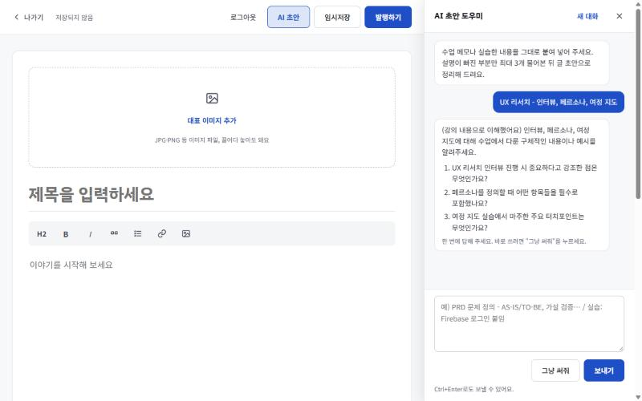
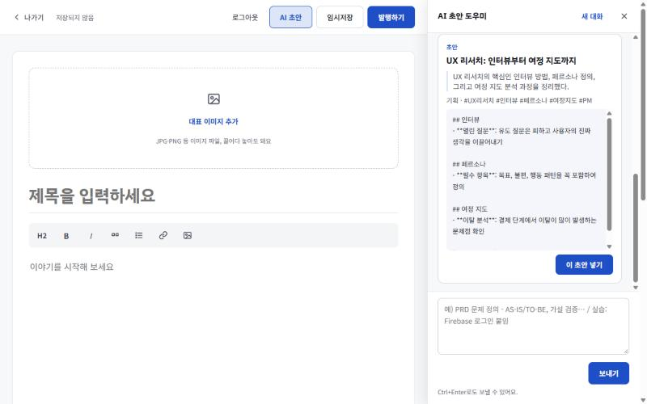

# 테스트 보고서 v1.3 — 수업 기록 → 블로그 초안 정리 챗봇

## 1. 개요
2026-11-24 · 작성자 정지나 · 기준 문서 docs/PRD.md v1.1 · 환경: 배포 주소 https://jinajung01.github.io/blog/write.html,
Chrome(PC 1280×800), 관리자 로그인, Firebase AI Logic(gemini-3.5-flash-lite) + App Check(reCAPTCHA Enterprise)

## 2. 유저플로우
**① 강의 메모 입력 → 질문 3개** 글쓰기 화면의 **AI 초안** → 메모를 보내면 강의로 구분하고 설명 없는 키워드를 묻는다

**② 답변 → 초안 카드** 한 번에 답하면 답을 반영한 초안(제목·요약·카테고리·태그·본문)이 나온다

**③ 이 초안 넣기 → 저장** 제목·본문(맨 위 요약)·카테고리·태그가 채워지고 "아직 저장 안 됨" → 기존 임시저장·발행으로 저장

**④ 섞인 입력** 관련 없는 강의·실습을 함께 넣어도 글 1개, 안에서 `## 강의`·`## 실습` 소제목으로 나뉜다

## 3. 기능별 테스트 (배포 주소, 실제 AI 호출)
| ID | 케이스 (PRD 기능) | 입력·조작 | 기대 결과 | 결과 |
|---|---|---|---|---|
| T1 | 강의만 (F2·F3·F4) | "UX 리서치 - 인터뷰, 페르소나, 여정 지도" | 강의로 구분, 질문 3개 이하 | 통과 (질문 3개) |
| T2 | 실습만 (F3·F4) | "실습: 글쓰기 화면에 챗봇 패널을 붙였는데 중간에 막힘" → 답변 | 실습으로 구분, 빠진 단계 질문 → 답 반영 초안 | 통과 |
| T3 | 섞인 입력, 관련 있음 (F2) | 강의 "프롬프트 설계" + 실습 "지시문에 JSON 형식 적용" | 강의+실습으로 구분, 글 1개 | 통과 |
| T4 | 섞인 입력, 관련 없음 (F2) | 강의 "OKR" + 실습 "Figma 로그인 화면"(설명 포함) | 질문 없이 글 1개, 강의·실습 소제목 | 통과 |
| T5 | 질문 건너뛰기 (F5) | T1 질문 뒤 "그냥 써줘" | 바로 초안, 빈 곳 "(설명 보충 필요)" | 통과 |
| T6 | 수정 요청 (F7) | "제목을 질문형으로 바꿔줘" | 제목이 질문형인 새 초안 | 1차 실패 → 수정 후 통과 |
| T7 | 초안 넣기 (F8) | 빈 글쓰기 칸 / 쓰던 글이 있을 때 넣기 | 칸 채움 / 패널 안 [취소]·[바꾸기] 확인 | 통과 |
| T8 | 비로그인 접근 (F1) | 시크릿 창에서 write.html 접속 | login.html로 이동, 구글 로그인 버튼만 표시 | 통과 |
| T9 | 확인형 질문 (F4) | "UX 리서치 - 인터뷰, 페르소나, 여정 지도" → "1번 맞아…" | 뜻을 제시하고 확인 → 확인한 뜻만 본문에 | 통과 (배포 주소 재확인) |
| T10 | 대화 기록 (F9) | 다시 열기 → "더 짧게" / 새 글 | 이어서 수정 / 빈 화면 + 불러오기 버튼 | 통과 (배포 주소 재확인) |
| T11 | 카테고리 (F6) | 크롬 확장 개발 실습 / Figma 화면 실습 | 기획 / 디자인 | 통과 (localhost) |
| T12 | 이름만 답함 (F6) | 5단계 이름만 입력 → "그냥 써줘" | 이름만 쓰고 설명·마무리 지어내지 않음, 도입 문장 있음 | 1차 실패(F-07) → 수정 후 통과 |

**자동 단위테스트** `node --test tests/` — 6개 모두 통과: 질문 최대 3개, 초안이 있으면 질문 무시,
카테고리 기획·디자인만, 태그 정리(# 제거·중복 제거), 빈 본문은 초안 아님, JSON이 아닌 답변 오류 처리
**응답 시간** 1.7~2.6초 (배포 주소 15회), 로그인 직후 첫 호출만 최대 23초
**PRD 가설 H4 (모드 선택 없이 강의·실습 구분)** 구분 정확도 4건 중 4건 — 강의(T1)·실습(T2)·섞인 입력(T3·T4) 모두 맞게 구분

## 4. 발견한 문제와 조치 (logs/success-fail-log.md)
| 번호 | 문제 | 조치 |
|---|---|---|
| F-03 | 키워드만 있는 메모에 질문 없이 일반 설명으로 초안을 채움 | 설명 없는 키워드가 있으면 반드시 먼저 질문, 일반 설명 금지 |
| F-04 | 앱 브라우저에서 새 대화·다시 넣기 버튼이 반응 없음 | 브라우저 확인 창 대신 패널 안 확인 버튼 |
| F-05 | PC에서 패널이 임시저장·발행 버튼을 가림 | 패널을 열면 화면 전체를 패널 너비만큼 줄임 |
| F-06 | 수정 요청이 초안에 반영되지 않음 (T6) | 지시문에 수정 예시와 "무엇을 바꿨는지 알림" 추가 |
| F-07·08 | 이름만 답해도 설명을 덧붙임(T12), 줄글 규칙 후 빈 연결 문장 | 이름만 쓰기 예시 추가, 연결 문장은 소제목 2개 이상일 때만 |

## 5. 남은 한계와 다음 확인
- 카테고리 추천: 개발 실습을 '디자인'으로 추천한 문제는 기준을 넣어 고침(T11). 애매한 글은 넣은 뒤 직접 확인
- 대화 기록은 이 브라우저에만 저장되어 다른 기기에서는 보이지 않음
- 사실 덧붙임: 실습 초안에 말하지 않은 단어("모바일")를 덧붙인 경우 1회 → 초안 확인 후 저장
- 지표(PRD 5. 가설 및 지표): 맥락 유지율·실습 기록률 변화는 실제 수업 기록을 쌓은 뒤 측정 (현재값 확인 필요)
